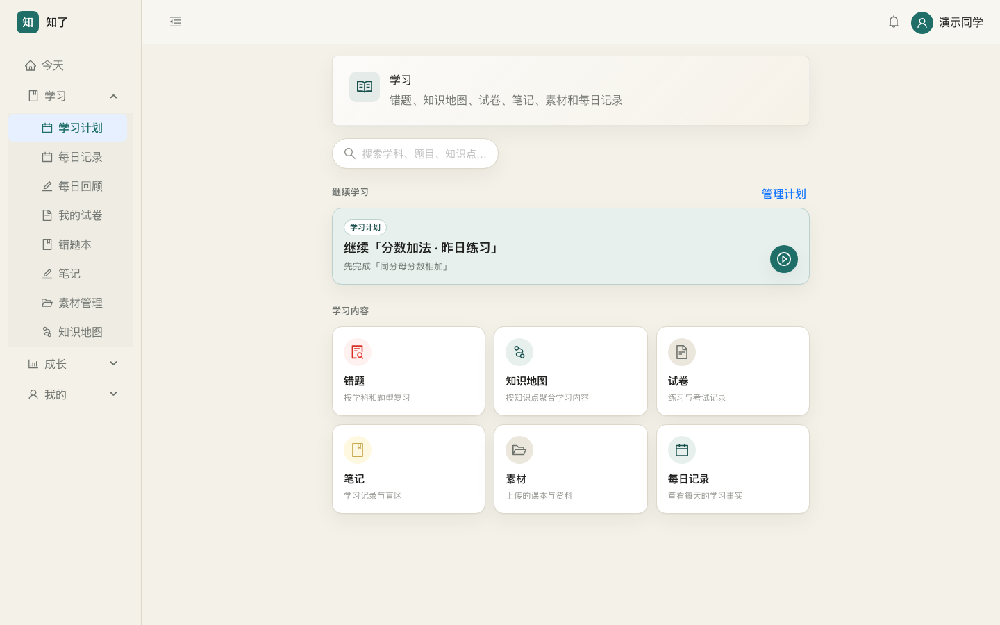
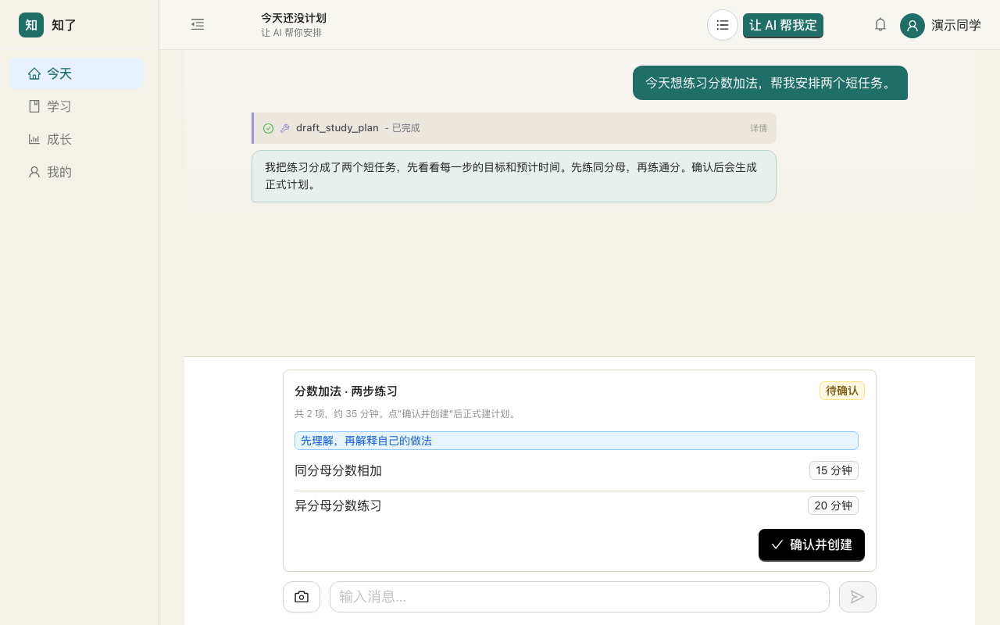
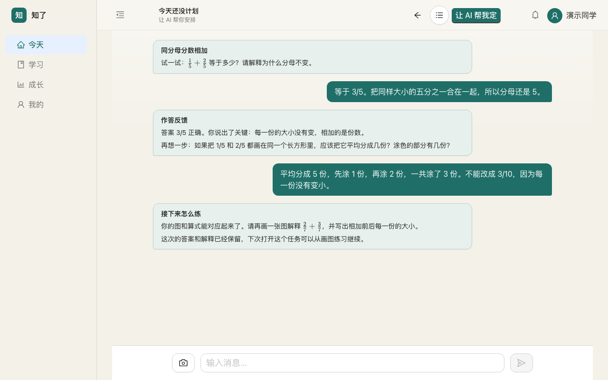
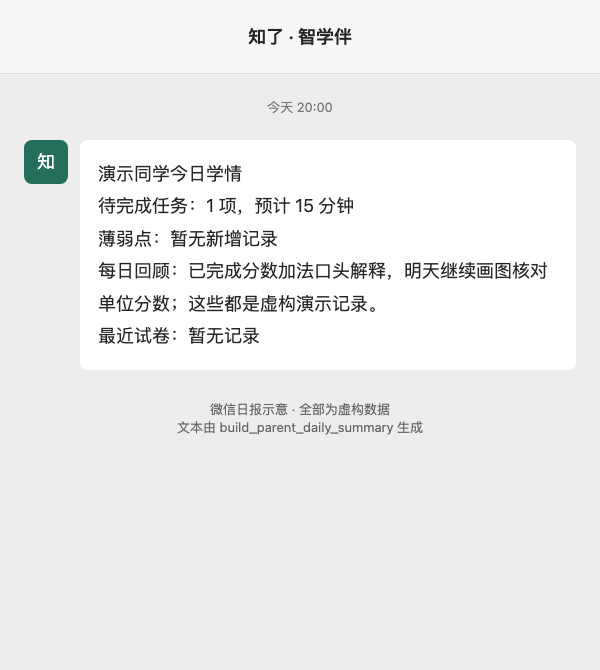
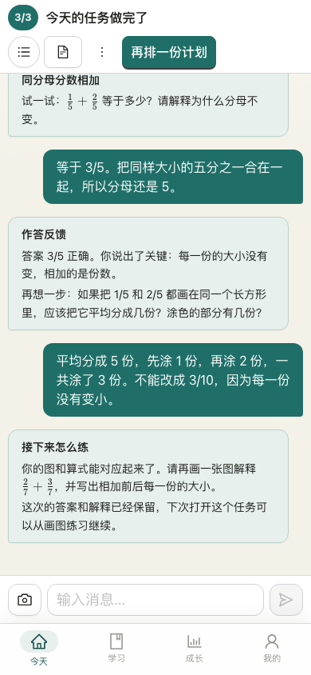
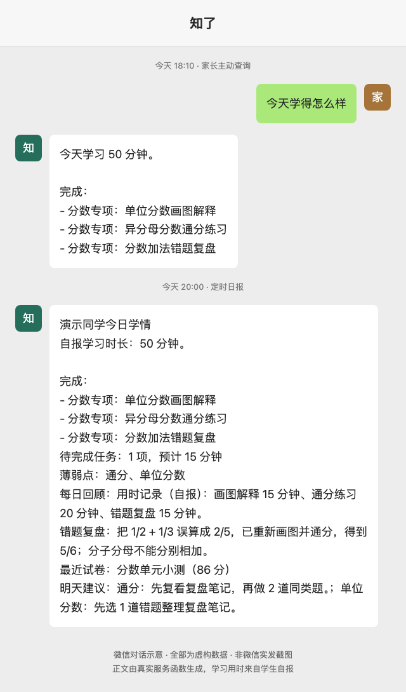
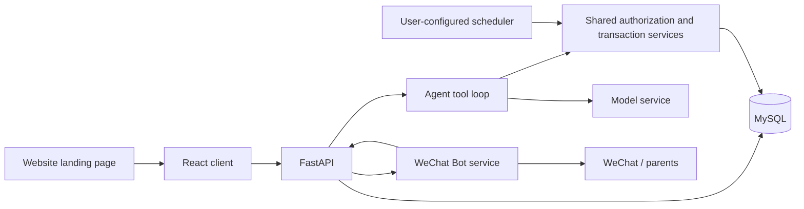

[简体中文](README.md) | [English](README.en.md)

<div align="center">
  
  <h1>StudyBuddy (知了)</h1>
  <p><strong>Help children know where to start, and let parents see what they learned through WeChat.</strong></p>
  <p>
    <a href="LICENSE"></a>
    
    
    
    
    <a href="https://github.com/bmdy6/studybuddy/actions/workflows/ci.yml"></a>
  </p>
  
</div>

[Quick start](#quick-start) · [WeChat reports](#let-parents-see-a-day-of-learning-in-wechat) · [Model configuration](#model-configuration)

## Why build this

Sometimes children want to learn but do not know where to start. A small task they can begin immediately is often more helpful than a long checklist. When parents cannot see the learning process, they end up asking and reminding repeatedly. I wanted a tool that connects starting, leaving a record, and continuing next time, while giving parents more visibility through WeChat.

## Three things to do well

| 📋 Daily plans | ✍️ Learning records | 💬 WeChat daily reports |
| :---: | :---: | :---: |
| See what to do first as soon as you open the app.<br>Carry unfinished items from yesterday into today and continue after confirmation. | Keep answer evidence, error reviews, and assessment records.<br>Reopen a task and continue from its existing conversation. | After binding, parents receive learning reports at their chosen time.<br>See what happened today and where support is still needed. |
| [](docs/images/plan-confirm.png) | [](docs/images/task-session.png) | [](docs/images/wechat-daily-demo.png) |

Plans begin as drafts and become real tasks only after clicking “Confirm and create.” Completion assessments require answer evidence, and repeated confirmation does not create duplicate plans.

<p align="center"></p>
<p align="center">Continue the same task on mobile. All app screenshots use fictional data in a disposable MySQL database, with no real model calls.</p>

## Let parents see a day of learning in WeChat

**The student learns → the system summarizes today's records → the Bot pushes a report at the parent's chosen time.**

<p align="center"></p>
<p align="center">Illustrated WeChat conversation using entirely fictional data. The on-demand reply is generated by <code>build_guardian_today_learning_summary</code>, and the evening report by <code>build_parent_daily_summary</code>. Both are real code output rendered by a script, not screenshots of messages actually sent through WeChat.</p>

Students scan a QR code under “Profile → WeChat learning assistant” to connect the Bot, then invite parents to bind their accounts. Parents can query learning progress, choose a child, and set the push time. Daily reports use learning records and evidence; the iLink parent channel also supports today's learning summaries and growth reports.

<details>
<summary>Limitations and notes</summary>

Scheduled reports require your own scheduler and are subject to WeChat interaction windows, quotas, and account status.

</details>

## More features

- **Notes**: organize explanations and materials into drafts, then confirm before saving.
- **Material parsing**: upload PDFs or photos and inspect recognized drafts, sources, and parsing status.
- **Practice and errors**: lightweight practice, formal exams, grading, and error-review entry points.
- **Family tasks**: submit completion evidence for parental confirmation and retain reward records.
- **Growth records**: view learning facts, summaries, and unfinished items by day.
- **Website landing page**: a separate build entry point, independent of the main client.
- **HobbyBuddy**: a separate conversational app for interest-based resources, reusing the model and resource-search foundation with independent accounts and a database.

[Feature-to-source map](docs/feature-map.md) · [Mobile plan page](docs/images/mobile-plan.png)

## How it connects



HTTP endpoints and Agent tools reuse the same services. The WeChat Bot is an optional separate process; the main application starts independently of it.

## Quick start

Requires Python 3.11+, Node.js 20.19+, and MySQL. Start from the repository root and prepare a **new empty database and dedicated account** for this application.

```bash
cd studybuddy-backend
python3.11 -m venv .venv
.venv/bin/python -m pip install -r requirements.txt
cp .env.example .env
```

Edit `.env` with your database connection, a random `JWT_SECRET`, and your model configuration. WeChat defaults to `WECHAT_ENABLED=false`; leave it disabled to try the main application first.

If using Docker, start a dedicated MySQL instance from the repository root (local port defaults to 3307; change `DB_PORT` in `.env` if needed):

```bash
docker compose --env-file studybuddy-backend/.env up -d db
```

Once the database is ready, initialize it and start the API from `studybuddy-backend`:

```bash
PYTHONPATH=. .venv/bin/python scripts/init_db.py
.venv/bin/uvicorn app.main:app --host 127.0.0.1 --port 8001
```

Initialization accepts only a database with no tables. It creates no default accounts and does not overwrite an existing database. Historical migrations in `sql/` are maintenance references; do not run them in bulk. In particular, `010_teacher_students.sql` backfills legacy single-family relationships and is unsuitable for multi-family databases.

Start the client in another terminal:

```bash
cd studybuddy-client
npm ci
cp .env.example .env.local
npm run dev -- --host 127.0.0.1
```

Open the address shown in the terminal and register a student account. The client connects to `http://127.0.0.1:8001` by default; restart or rebuild after changing `VITE_API_BASE`. Build the main application with `npm run build`. For the website, use `npm run dev:landing` (open `/landing.html`) or `npm run build:landing`; output is `dist-landing/landing.html`. Set `VITE_APP_URL` to the client URL used by the website buttons; it defaults to the local machine.

### Enable WeChat daily reports

1. In the backend `.env`, set `WECHAT_ENABLED=true`, `WECHAT_BOT_SERVICE_URL=http://127.0.0.1:8011`, a random `WECHAT_BOT_INTERNAL_TOKEN`, and your client binding URL as `WECHAT_PARENT_INVITATION_URL=https://your-client.example/#/wechat-parent-bind`. Restart the backend.
2. In the client `.env.local`, set `VITE_WECHAT_ENABLED=true` and restart or rebuild the client.
3. Create a **separate virtual environment** for the Bot (Hermes and the backend require different dependency versions), install dependencies, and export configuration. From the repository root:

   ```bash
   python3.11 -m venv wechat_bot_service/.venv
   wechat_bot_service/.venv/bin/python -m pip install -r wechat_bot_service/requirements.txt
   cp wechat_bot_service/.env.example wechat_bot_service/.env
   # Edit .env first: use the same token as the backend and an independent absolute HERMES_HOME path.
   # After reviewing the configuration, export it; the Bot does not load this file automatically.
   set -a
   source wechat_bot_service/.env
   set +a
   wechat_bot_service/.venv/bin/python -m wechat_bot_service
   ```

   The [Bot configuration example](wechat_bot_service/.env.example) explains `WECHAT_BOT_ILINK_*`, callback URLs, timeouts, listening ports, and chunk-retry settings. `HERMES_HOME` stores WeChat account credentials; keep it outside the repository.
4. Scan the QR code in the student's profile to connect the Bot and generate a parent invitation. Parents bind their accounts and set the daily push time. The backend validates accounts, student ownership, and unbinding.
5. Use your own cron or scheduler to run the following commands every minute from `studybuddy-backend`. Refresh daily records before dispatching due reminders; refreshing records with learning facts may call the configured model:

   ```bash
   PYTHONPATH=. .venv/bin/python scripts/refresh_daily_learning_records.py
   PYTHONPATH=. .venv/bin/python scripts/dispatch_wechat_parent_reminders.py
   ```

Starting the Bot alone does not install a scheduler. Check local service logs first, then try binding and sending once with your own account. This repository's automated verification uses adapter substitutes and does not cover real WeChat QR login or message delivery.

## Model configuration

<details>
<summary>Expand MiMo / OpenAI configuration instructions</summary>

Store the key in the backend environment variable `LLM_API_KEY`. Set the model and parameter style in the `llm` section of `studybuddy-backend/config.yaml`, retaining other timeout and retry settings.

MiMo:

```yaml
provider: mimo
model: mimo-v2.5
reasoning_effort: none
```

Set `LLM_BASE_URL=https://api.xiaomimimo.com/v1`. `none` uses MiMo's `thinking.type=disabled`.

OpenAI:

```yaml
provider: openai
model: gpt-6-luna
reasoning_effort: none
```

Set `LLM_BASE_URL=https://api.openai.com/v1`. This branch uses `max_completion_tokens` and standard `reasoning_effort`. Refer to the [official model documentation](https://developers.openai.com/api/docs/models) for model availability and parameter requirements.

Without a key, model requests explicitly fail rather than producing fake answers. Tool calls, streaming, and image capabilities of other compatible services require your own verification. Tencent Cloud COS, video transcription, and external search are optional too; local file storage is used when COS is not configured.

</details>

## Limitations and notes

This is a self-hosted project requiring your own model key. AI explanations, grading, and completion assessments need review, cannot prove mastery, and do not promise improved grades. Deployers are responsible for HTTPS, access control, backups, and upload permissions on public deployments.

[Testing](docs/testing.md) · [Verification record](docs/full-source-verification.md) · [Provenance and feature boundaries](docs/source-boundary.md) · [Screenshot sources and reproduction](docs/images/SOURCES.md) · [Third-party dependencies](THIRD_PARTY_NOTICES.md) · [AGPL-3.0-only](LICENSE)
