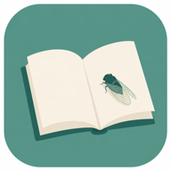
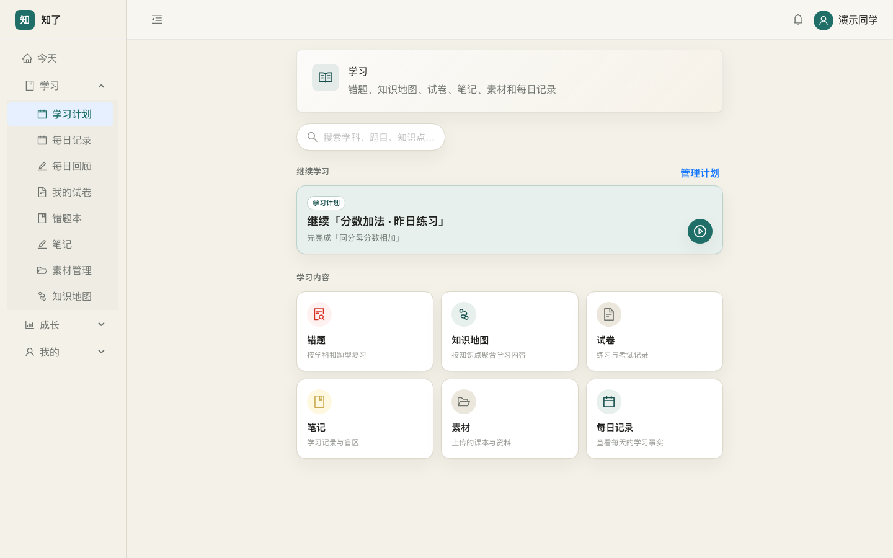
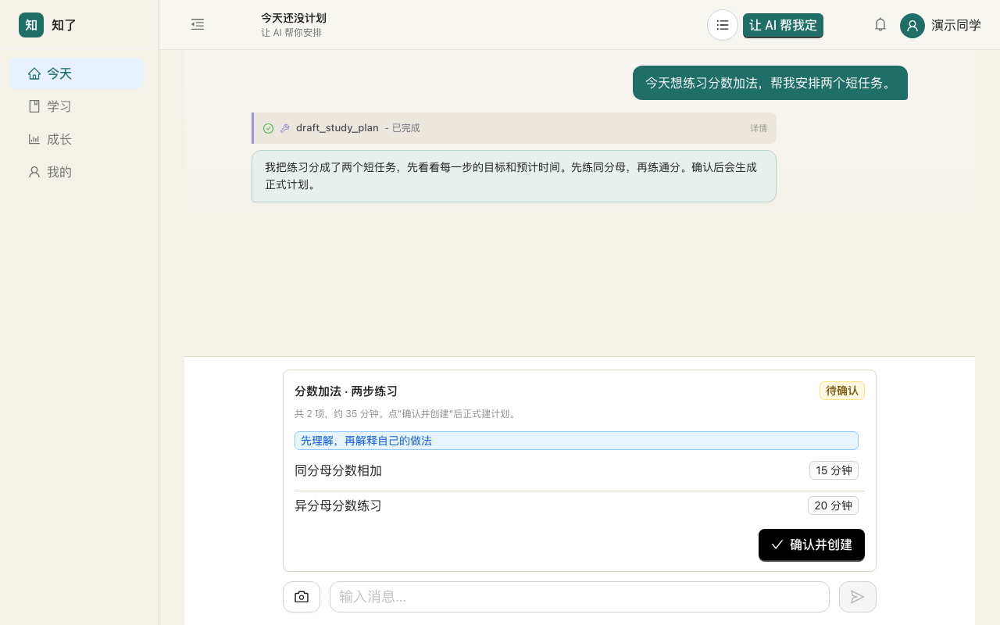
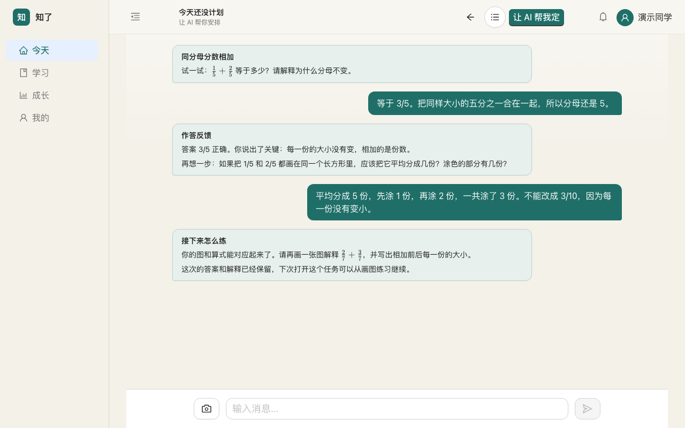
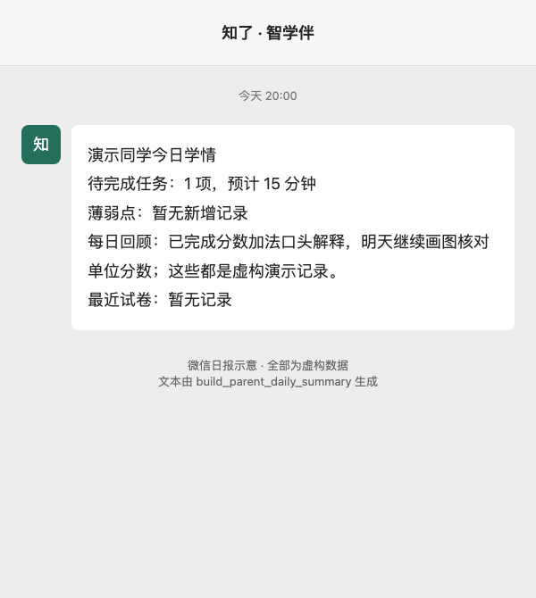
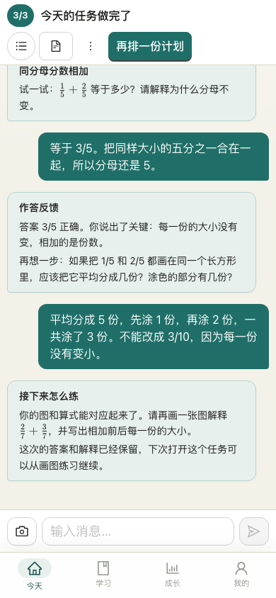
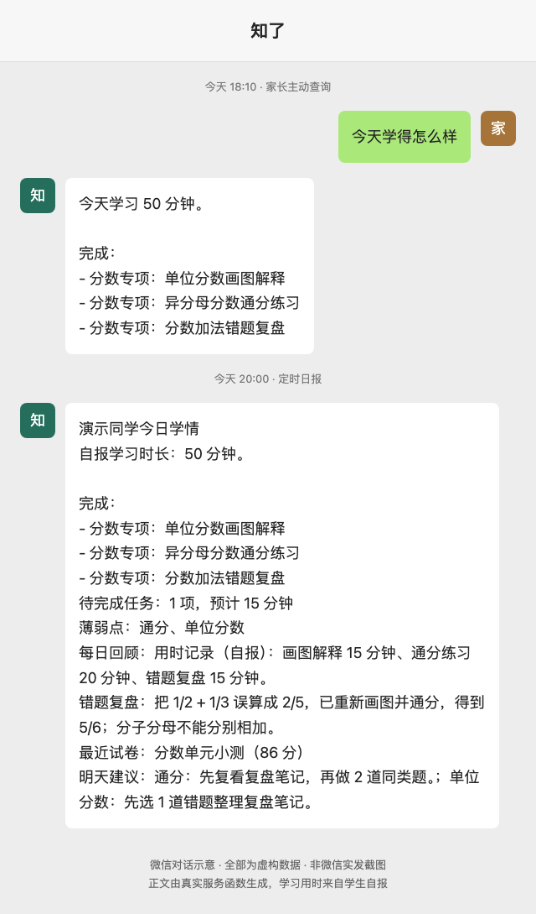
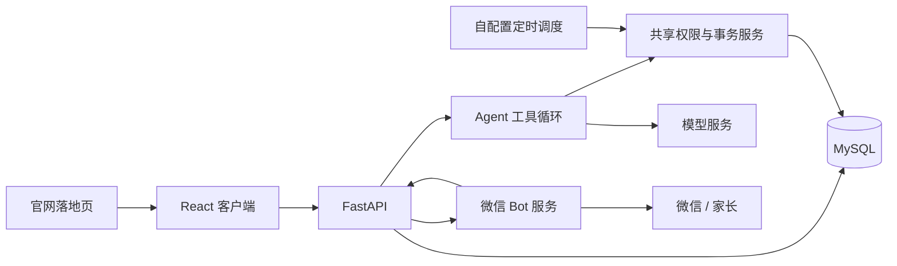

[简体中文](README.md) | [English](README.en.md)

<div align="center">
  
  <h1>知了（StudyBuddy）</h1>
  <p><strong>孩子知道第一步做什么，家长在微信里看见孩子学了什么。</strong></p>
  <p>
    <a href="LICENSE"></a>
    
    
    
    
    <a href="https://github.com/bmdy6/studybuddy/actions/workflows/ci.yml"></a>
  </p>
  
</div>

[快速开始](#快速开始) · [微信日报](#家长在微信里看见一天的学习) · [模型配置](#模型配置)

## 为什么做这个

有时孩子不是不想学，而是不知道第一步该做什么。一份很长的任务清单，往往还不如一个能马上开始的小任务。家长看不见学习过程，只能反复问、反复催。我想做一个把「开始、留下记录、下次继续」连起来的工具，也让家长在微信里多看见一点过程。

## 三件想做好的事

| 📋 每日计划 | ✍️ 学习留痕 | 💬 微信日报 |
| :---: | :---: | :---: |
| 今天先做什么，打开就能看见。<br>昨日没完成的项目可以沿用到今天，确认后继续。 | 保留作答证据、错题复盘和判定记录。<br>再次打开任务，从已有对话接着学。 | 家长绑定后，按设置时间接收学习汇报。<br>知道今天做了什么、还有什么需要陪伴。 |
| [](docs/images/plan-confirm.png) | [](docs/images/task-session.png) | [](docs/images/wechat-daily-demo.png) |

计划先出草案，点击「确认并创建」后才成为正式任务；完成判定需要作答证据，重复确认也不会重复建计划。

<p align="center"></p>
<p align="center">手机上也能继续同一项任务。应用截图均来自一次性 MySQL 中的虚构数据，未调用真实模型。</p>

## 家长在微信里，看见一天的学习

**学生学习 → 系统汇总当日记录 → Bot 按家长设置的时间推送。**

<p align="center"></p>
<p align="center">微信对话示意，全部使用虚构数据；主动回复由 <code>build_guardian_today_learning_summary</code> 生成，晚间日报由 <code>build_parent_daily_summary</code> 生成，均为真实代码输出，经脚本渲染，非微信实发截图。</p>

学生在「个人中心 → 微信学习助手」扫码连接 Bot，再邀请家长绑定。家长可以查询学情、选择孩子、设置推送时间。日报使用学习记录和证据；iLink 家长通道还支持当天学习摘要与成长汇报。

<details>
<summary>边界与说明</summary>

定时日报需自配调度，并受微信互动窗口、配额及账号状态限制。

</details>

## 还有这些功能

- **笔记**：从讲解和素材整理草稿，确认后保存。
- **素材解析**：上传 PDF 或照片，查看识别稿、来源和解析状态。
- **练习与错题**：轻量练习、正式试卷、批改与错题复习入口。
- **家庭任务**：提交完成证据，交由家长确认，保留奖励记录。
- **成长记录**：按天查看学习事实、摘要和未完成项目。
- **官网落地页**：独立构建入口，和业务客户端分开使用。
- **HobbyBuddy**：独立兴趣资源对话应用，复用模型与资源搜索底座，使用独立账号和数据库。

[功能与源码入口对照](docs/feature-map.md) · [手机计划页](docs/images/mobile-plan.png)

## 怎么连起来



HTTP 接口和 Agent 工具复用同一套服务。微信 Bot 是可选的独立进程，主应用不依赖它启动。

## 快速开始

需要 Python 3.11+、Node.js 20.19+ 和 MySQL。先进入仓库根目录，为这个应用准备**全新的空数据库与专用账号**。

```bash
cd studybuddy-backend
python3.11 -m venv .venv
.venv/bin/python -m pip install -r requirements.txt
cp .env.example .env
```

编辑 `.env`：填写数据库连接、随机 `JWT_SECRET` 和自己的模型配置。微信默认 `WECHAT_ENABLED=false`，保持关闭即可先用主应用。

如果使用 Docker，在仓库根目录启动独立 MySQL（本机端口默认 3307，可在 `.env` 改 `DB_PORT`）：

```bash
docker compose --env-file studybuddy-backend/.env up -d db
```

等待数据库就绪，在 `studybuddy-backend` 初始化并启动 API：

```bash
PYTHONPATH=. .venv/bin/python scripts/init_db.py
.venv/bin/uvicorn app.main:app --host 127.0.0.1 --port 8001
```

初始化只接受没有任何表的库，不创建默认账号、不覆盖旧库。`sql/` 中的历史迁移供维护参考，请勿批量执行；其中 `010_teacher_students.sql` 是旧单家庭关系回填，不适用于多家庭数据库。

另开终端启动客户端：

```bash
cd studybuddy-client
npm ci
cp .env.example .env.local
npm run dev -- --host 127.0.0.1
```

打开终端显示的地址，注册学生账号。客户端默认连接 `http://127.0.0.1:8001`；修改 `VITE_API_BASE` 后需重启或重建。主应用可用 `npm run build` 构建；官网使用 `npm run dev:landing`（打开 `/landing.html`）或 `npm run build:landing`，产物在 `dist-landing/landing.html`。通过 `VITE_APP_URL` 设置官网按钮指向的客户端地址，默认指向本机。

### 开启微信日报

1. 后端 `.env` 设置 `WECHAT_ENABLED=true`、`WECHAT_BOT_SERVICE_URL=http://127.0.0.1:8011`、随机 `WECHAT_BOT_INTERNAL_TOKEN`，以及你自己的客户端绑定地址 `WECHAT_PARENT_INVITATION_URL=https://your-client.example/#/wechat-parent-bind`。重启后端。
2. 客户端 `.env.local` 设置 `VITE_WECHAT_ENABLED=true`，重启或重建客户端。
3. 为 Bot **单独建立虚拟环境**（Hermes 与后端依赖版本不同），安装并导出配置。在仓库根目录运行：

   ```bash
   python3.11 -m venv wechat_bot_service/.venv
   wechat_bot_service/.venv/bin/python -m pip install -r wechat_bot_service/requirements.txt
   cp wechat_bot_service/.env.example wechat_bot_service/.env
   # 先编辑 .env：token 与后端一致，HERMES_HOME 使用独立的绝对路径
   # 确认配置后导出；本文件不会由 Bot 自动加载
   set -a
   source wechat_bot_service/.env
   set +a
   wechat_bot_service/.venv/bin/python -m wechat_bot_service
   ```

   [Bot 配置示例](wechat_bot_service/.env.example) 逐项说明 `WECHAT_BOT_ILINK_*`、回调地址、超时、监听端口和分片重试参数。`HERMES_HOME` 会保存微信账号凭据，务必放在仓库外。
4. 在学生个人中心扫码连接 Bot，生成家长邀请；家长完成绑定，设置每日推送时间。账号、学生归属和解绑都由后端校验。
5. 用你自己的 cron 或调度器，每分钟在 `studybuddy-backend` 目录运行以下命令。需要先刷新每日记录，再派发到期提醒；刷新有学习事实时可能调用已配置的模型：

   ```bash
   PYTHONPATH=. .venv/bin/python scripts/refresh_daily_learning_records.py
   PYTHONPATH=. .venv/bin/python scripts/dispatch_wechat_parent_reminders.py
   ```

仅启动 Bot 不会自动安装调度。先检查本地服务日志，再尝试自己账号的一次绑定和发送；本仓库的自动化验证使用适配器替身，不包含真实微信扫码或消息投递验收。

## 模型配置

<details>
<summary>展开 MiMo / OpenAI 配置说明</summary>

密钥放在后端环境变量 `LLM_API_KEY` 中；模型和参数风格在 `studybuddy-backend/config.yaml` 的 `llm` 段设置，保留其他超时和重试配置。

MiMo：

```yaml
provider: mimo
model: mimo-v2.5
reasoning_effort: none
```

设置 `LLM_BASE_URL=https://api.xiaomimimo.com/v1`。`none` 使用 MiMo 的 `thinking.type=disabled`。

OpenAI：

```yaml
provider: openai
model: gpt-6-luna
reasoning_effort: none
```

设置 `LLM_BASE_URL=https://api.openai.com/v1`。这一分支使用 `max_completion_tokens` 和标准 `reasoning_effort`；模型可用性和参数要求请以 [官方模型文档](https://developers.openai.com/api/docs/models) 为准。

没有密钥时模型请求会明确报错，不生成假回答。其他兼容服务的工具调用、流式响应和图片能力需自行验证。腾讯云 COS、视频转写和外部搜索也都是可选配置；未配置 COS 时使用本地文件存储。

</details>

## 边界与说明

这是自托管项目，需要自己的模型 key。AI 的讲解、批改和完成判定都需要核对，不能作为已经掌握知识的证明，也不承诺提分。公开部署的 HTTPS、访问控制、备份和上传文件权限由部署者负责。

[测试说明](docs/testing.md) · [验证记录](docs/full-source-verification.md) · [来源与功能边界](docs/source-boundary.md) · [截图来源与复现](docs/images/SOURCES.md) · [第三方依赖](THIRD_PARTY_NOTICES.md) · [AGPL-3.0-only](LICENSE)
